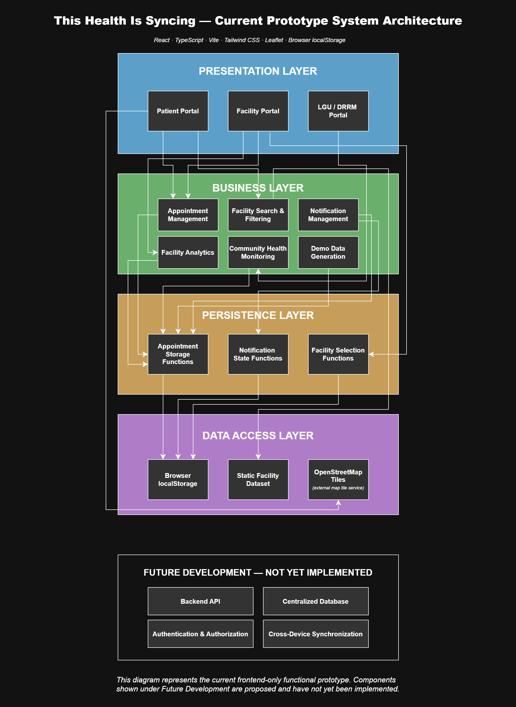

# This Health Is Syncing

**Community Healthcare Coordination Platform**

*Connecting care. Empowering communities.*

This Health Is Syncing is a frontend-based healthcare coordination platform developed as a functional prototype for the **BetterGov Fellowship 2026–2027**.

The platform aims to improve coordination among patients, healthcare facilities, and local government units (LGUs) by providing a unified interface for appointment management, facility discovery, service monitoring, and healthcare analytics.

> **Development Status:** Functional frontend prototype. The platform is under active development and currently uses fictional healthcare facilities and simulated appointment data. Backend services, centralized databases, and real user authentication have not yet been implemented.

## Key Features

### 1. Patient Portal

The Patient Portal allows patients to discover healthcare facilities and manage consultation appointments.

- Search and filter healthcare facilities by available services and ownership.
- View healthcare facility locations through an interactive map.
- Complete a consultation questionnaire.
- Submit appointment requests.
- Track appointment statuses and history.
- Accept proposed appointment schedules or request changes.
- View appointment-related notifications.

### 2. Healthcare Facility Portal

The Healthcare Facility Portal allows healthcare providers to manage appointment requests and monitor facility activity.

- Select a healthcare facility within the prototype.
- View incoming consultation requests.
- Approve, reschedule, or decline appointments.
- Mark consultations as completed.
- Monitor appointment statistics and facility activity.
- Review appointment event histories.
- Receive notifications about appointment updates.

### 3. LGU / DRRM Portal

The LGU/DRRM Portal provides an overview of healthcare service activity to support local monitoring and planning.

- View aggregated appointment and service statistics.
- Analyze healthcare service demand and trends.
- Monitor simulated alerts based on appointment activity.
- Explore healthcare activity through an interactive map.
- Generate and clear fictional demonstration records for testing and presentation.

The analytics and monitoring features currently operate on simulated data and do not represent live healthcare surveillance or verified public health forecasts.

## Technology Stack

| Technology | Purpose |
|---|---|
| React | User interface development |
| TypeScript | Type-safe application development |
| Vite | Development server and build tooling |
| Tailwind CSS | Interface styling |
| React Router | Client-side navigation |
| Lucide React | Interface icons |
| React Leaflet / Leaflet | Interactive map functionality |
| OpenStreetMap | Map tile resources |
| Browser localStorage | Local persistence of prototype data |

## System Architecture

The current prototype follows a conceptual four-layer architecture:

1. **Presentation Layer** — Patient, Healthcare Facility, and LGU/DRRM portals.
2. **Business Layer** — Appointment management, facility search and filtering, notification management, analytics, monitoring, and demonstration data generation.
3. **Persistence Layer** — Functions responsible for storing and retrieving appointment records, notification states, and facility selection information.
4. **Data Access Layer** — Browser localStorage, static healthcare facility data, and external OpenStreetMap resources.

These layers represent logical responsibilities within the frontend application rather than independently deployed services.



The editable architecture diagram is available in [`docs/system-architecture.drawio`](docs/system-architecture.drawio).

## Getting Started

### Prerequisites

Ensure that the following are installed:

- Node.js
- npm
- Git

### Installation

**1. Clone the repository**

```bash
git clone https://github.com/stellunyxx/this-health-is-syncing.git
```

**2. Navigate to the project directory**

```bash
cd aio-healthcare-platform
```

**3. Install dependencies**

```bash
npm install
```

**4. Start the development server**

```bash
npm run dev
```

**5. Open the application**

Open the local URL displayed in the terminal, typically:

```text
http://localhost:5173/
```

### Production Build

To generate an optimized production build:

```bash
npm run build
```

To preview the build locally:

```bash
npm run preview
```

## Prototype Data and Limitations

This Health Is Syncing is currently designed for demonstration and development purposes.

- Healthcare facilities included in the prototype are fictional.
- Appointment records and monitoring data are simulated.
- Data is stored locally within the browser using `localStorage`.
- Data is not automatically synchronized between different browsers, devices, or users.
- The application does not currently provide production-ready authentication or authorization.
- The platform is not connected to real healthcare facility databases or government health information systems.
- The prototype should not be used to store real patient information or manage actual medical consultations.

## Future Development

The following components are planned for future implementation:

- **Backend API** — Centralized processing of application requests and business operations.
- **Centralized Database** — Secure storage and retrieval of healthcare coordination records.
- **Authentication and Authorization** — User authentication and role-based access controls.
- **Cross-Device Synchronization** — Shared, synchronized information across patient, healthcare facility, and LGU interfaces.

Additional functionality and integrations will be evaluated as the project progresses.

## Project Status

**Current Stage:** Functional Frontend Prototype

The application demonstrates the intended workflows and interactions among patients, healthcare facilities, and LGUs.

It serves as an initial proof of concept for a more comprehensive healthcare coordination system.

## Disclaimer

This Health Is Syncing is an experimental civic-technology prototype developed for demonstration purposes.

It is not a deployed healthcare service, and its simulated information should not be used for medical, emergency response, or public health decisions.
